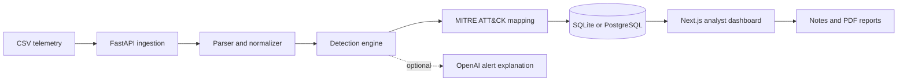

# SentinelAI

> Upload security telemetry, surface suspicious behavior, and investigate MITRE-mapped alerts from one dashboard.

[](apps/backend/tests) [](apps/frontend) [](apps/backend)

SentinelAI is an ML-powered cybersecurity threat-detection MVP. It ingests authentication and network CSV logs, detects risky patterns, maps them to MITRE ATT&CK, and turns findings into analyst-ready explanations and PDF incident reports.

## What you can do

| Upload | Detect | Investigate | Report |
| --- | --- | --- | --- |
| Import CSV authentication and network telemetry. | Find failed login bursts, impossible travel, privilege escalation, beaconing, and ML anomalies. | Prioritize alerts by risk, inspect evidence, and capture analyst notes. | Export an incident PDF for an individual alert. |

## System flow



## Quick start

### Docker

```bash
cp .env.example .env
docker compose up --build
```

Open the [dashboard](http://localhost:3000) and [API documentation](http://localhost:8000/docs). Docker Compose starts the Next.js frontend, FastAPI backend, and PostgreSQL database.

### Local development

Run the backend (uses SQLite when `DATABASE_URL` is unset):

```bash
cd apps/backend
python -m venv .venv
source .venv/bin/activate
pip install -r requirements.txt
uvicorn app.main:app --reload
```

In another terminal, run the dashboard:

```bash
cd apps/frontend
npm install
npm run dev
```

The local API accepts requests from both `http://localhost:3000` and `http://127.0.0.1:3000`.

## Try it in two minutes

1. Open the dashboard and register an analyst account.
2. Choose **Upload CSV**.
3. Upload [auth_network_logs.csv](sample-data/auth_network_logs.csv).
4. Review alerts, evidence, risk scores, and MITRE mappings.
5. Select an alert to add a note or export its PDF.

### Sample scenarios

| File | Expected result |
| --- | --- |
| [auth_network_logs.csv](sample-data/auth_network_logs.csv) | Full demo: six alerts across several detectors. |
| [normal_baseline.csv](sample-data/normal_baseline.csv) | No alerts; a clean baseline. |
| [failed_login_burst.csv](sample-data/failed_login_burst.csv) | Failed login burst. |
| [impossible_travel.csv](sample-data/impossible_travel.csv) | Impossible-travel login. |
| [periodic_beaconing.csv](sample-data/periodic_beaconing.csv) | Periodic outbound beaconing. |
| [privilege_escalation.csv](sample-data/privilege_escalation.csv) | Privilege escalation or role change. |
| [invalid_missing_columns.csv](sample-data/invalid_missing_columns.csv) | A clear CSV-validation error. |

## Detection coverage

| Detection | Signal | MITRE ATT&CK |
| --- | --- | --- |
| Failed login burst | Five or more failed logins from one user/IP in ten minutes | T1110 — Brute Force |
| Impossible travel | Successful logins too far apart for the elapsed time | T1078 — Valid Accounts |
| Privilege escalation | Privileged role or permission change | T1068 — Exploitation for Privilege Escalation |
| Beaconing | Regular outbound connections to the same destination | T1071 — Application Layer Protocol |
| ML anomaly | Isolation Forest outlier across telemetry features | T1036 — Masquerading |

## API at a glance

| Endpoint | Purpose |
| --- | --- |
| `POST /auth/register` | Create an analyst account. |
| `POST /auth/login` | Obtain a JWT access token. |
| `POST /logs/upload` | Upload a CSV and generate alerts. |
| `GET /alerts` | List investigation alerts. |
| `POST /alerts/{alert_id}/notes` | Add an analyst note. |
| `GET /reports/{alert_id}/pdf` | Download an incident report. |

Register through the UI, or call the API directly:

```bash
curl -X POST http://localhost:8000/auth/register \
  -H "Content-Type: application/json" \
  -d '{"email":"analyst@example.com","password":"sentinel123"}'
```

## Configuration

| Variable | Default | Description |
| --- | --- | --- |
| `DATABASE_URL` | `sqlite:///./sentinelai.db` | SQLAlchemy database connection; PostgreSQL/Supabase-ready. |
| `JWT_SECRET` | Development-only value | Secret used to sign access tokens. Set a strong value outside local development. |
| `OPENAI_API_KEY` | Unset | Enables LLM-backed alert explanations; a deterministic local explanation is used otherwise. |
| `CORS_ORIGINS` | Local dashboard origins | Comma-separated browser origins allowed to call the API. |

For PostgreSQL or Supabase, use a SQLAlchemy URL such as:

```bash
export DATABASE_URL="postgresql+psycopg://postgres:<password>@<host>:5432/postgres"
```

## Quality checks

```bash
cd apps/backend && pytest
cd apps/frontend && npm run lint && npm run typecheck
```

## Project layout

```text
apps/
  backend/     FastAPI API, database models, detection engine, tests
  frontend/    Next.js dashboard and CSV upload UI
sample-data/   Ready-to-upload telemetry scenarios
docs/          Architecture notes
```

## Production notes

- Store `JWT_SECRET` and `OPENAI_API_KEY` in a secret manager.
- Run FastAPI behind TLS and restrict `CORS_ORIGINS` to deployed dashboard URLs.
- Use PostgreSQL or Supabase instead of SQLite for persistent environments.
- Add object storage for large raw-log uploads.
- Associate alerts with users or tenant workspaces before multi-user use.
